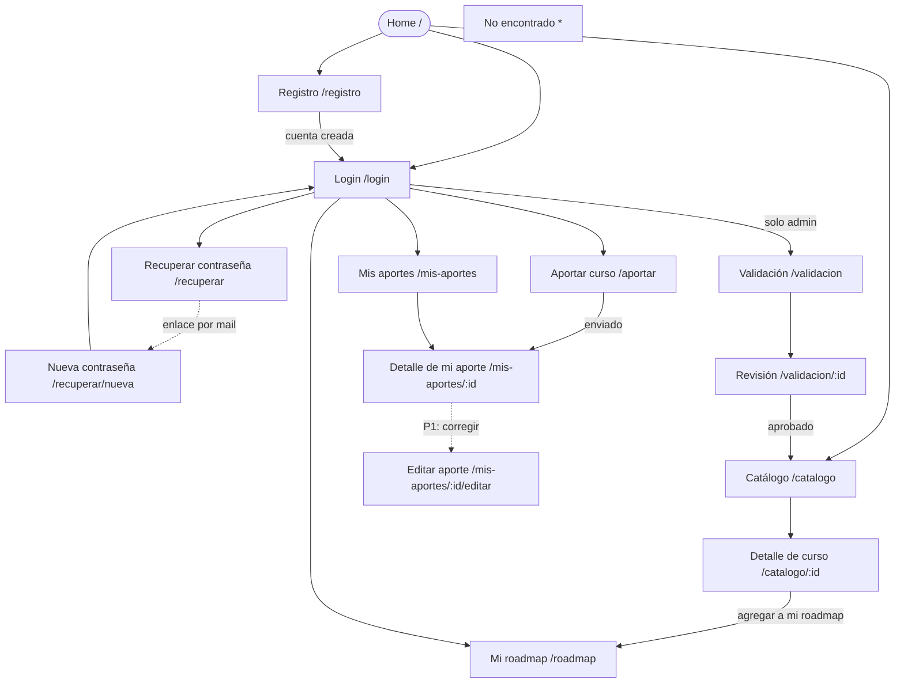

# APPFlow — Mapa del sitio y flujos de usuario — Senda

> **Qué es:** el esqueleto de navegación de Senda: todas las pantallas con su ruta, una ficha por
> pantalla (con las APIs que consume, todas definidas en el [BackendSchema](BackendSchema.md)) y
> los flujos de punta a punta. Puente entre el [PRD](PRD.md) y el backend.

## 1. Sitemap

> Desde cualquier pantalla, el header y el menú sándwich llevan a Home, Catálogo, Aportar curso,
> Mis aportes, Mi roadmap, Validación (solo admin) e Ingresar / Salir.

## 2. Rutas

| Ruta | Pantalla | Requiere login | Notas |
|------|----------|----------------|-------|
| `/` | Home | no | buscador, chips de categorías, últimos 6 cursos publicados |
| `/catalogo` | Catálogo comunitario (paginado) | no | query: `page`, `categoria` (id), `q` (texto) |
| `/catalogo/:id` | Detalle de curso | no | "Agregar a mi roadmap" requiere sesión |
| `/registro` | Crear cuenta | no | con sesión activa → redirect a `/catalogo` |
| `/login` | Ingresar | no | query `next` para volver a la ruta pedida; con sesión → `/catalogo` |
| `/recuperar` | Pedir enlace de recuperación | no | |
| `/recuperar/nueva` | Definir nueva contraseña | no | query `token` (llega en el mail) |
| `/aportar` | Formulario de aporte | sí | |
| `/mis-aportes` | Mis aportes (paginado) | sí | query: `page`, `estado` |
| `/mis-aportes/:id` | Detalle / estado de mi aporte | sí | solo el autor (o admin) |
| `/mis-aportes/:id/editar` | Corregir y reenviar aporte rechazado | sí | **P1** (US-012) |
| `/roadmap` | Mi roadmap (paginado) | sí | query: `page`, `estado` |
| `/validacion` | Aportes pendientes (paginado) | sí, rol `admin` | query: `page` |
| `/validacion/:id` | Revisión de un aporte | sí, rol `admin` | aprobar / rechazar con motivo |
| `*` | No encontrado | no | link a Home y al Catálogo |

## 3. Fichas de pantalla

> El shell (header + drawer) es común a todas: al iniciar la app, si hay token guardado, llama a
> `GET /api/v1/auth/me` para restaurar la sesión (BackendSchema §3.1).

### Pantalla: Home (`/`)

- **Objetivo del usuario:** entender qué es Senda y llegar rápido a un curso o al catálogo.
- **Componentes (de la UX-UI):** header, buscador (§5), chips de filtro de categorías (§4.10), grilla de 6 cards (§4.3), skeleton, CTA "Aportá un curso".
- **Estados:** `loading` (skeleton de 6 cards) · `ok` · `empty` (sin cursos publicados: empty state con CTA aportar) · `error` (banner con reintentar solo en la sección de cursos).
- **APIs que consume:** `GET /api/v1/cursos?page=1&page_size=6` · `GET /api/v1/categorias?page_size=100` → BackendSchema §3.2
- **Navegación:** buscar → `/catalogo?q=…`; chip → `/catalogo?categoria=<id>`; card → `/catalogo/:id`; CTA → `/aportar`.

### Pantalla: Catálogo comunitario (`/catalogo`)

- **Objetivo del usuario:** descubrir cursos validados filtrando por categoría o texto.
- **Componentes:** header, barra de búsqueda + select de categoría (plegable en la base), grilla de cards con estado "en tu roadmap", paginador, empty state, skeleton.
- **Estados:** `loading` (skeleton de 12 cards) · `ok` · `empty` (sin resultados: "Limpiar filtros" / "Aportá un curso") · `error` (banner con reintentar) · página fuera de rango.
- **APIs que consume:** `GET /api/v1/cursos?page=…&page_size=12&categoria_id=…&q=…` (con token, cada ítem trae `en_mi_roadmap`) · `GET /api/v1/categorias?page_size=100` → BackendSchema §3.2
- **Navegación:** desde Home y menú; hacia Detalle de curso; CTA hacia Aportar.

### Pantalla: Detalle de curso (`/catalogo/:id`)

- **Objetivo del usuario:** conocer las condiciones del curso y sumarlo a su roadmap o ir a la plataforma.
- **Componentes:** chip de categoría, título, ficha `<dl>` con todos los datos (incluida la declaración "El aportante lo tomó: sí/no"), botón primario "Agregar a mi roadmap" (o badge "En tu roadmap"), botón secundario "Ir al curso" (pestaña nueva, `rel="noopener noreferrer"`), snackbar.
- **Estados:** `loading` (skeleton de detalle) · `ok` · `en tu roadmap` · `agregando` (botón loading) · `no encontrado` (404) · `error` (banner con reintentar).
- **APIs que consume:** `GET /api/v1/cursos/{id}` → BackendSchema §3.2 · `POST /api/v1/roadmap/items` → BackendSchema §3.5
- **Navegación:** desde Catálogo, Home y Mi roadmap; "Agregar" sin sesión → `/login?next=/catalogo/:id`; tras agregar, snackbar con acción "Ver roadmap" → `/roadmap`.

### Pantalla: Registro (`/registro`)

- **Objetivo del usuario:** crear su cuenta.
- **Componentes:** formulario (nombre, email, contraseña con botón mostrar/ocultar y ayuda de requisitos), botón primario "Crear cuenta", link "Ya tengo cuenta".
- **Estados:** `default` · `error de campo` (422) · `email ya registrado` (409, error en el campo email) · `enviando` · `error de red` (snackbar).
- **APIs que consume:** `POST /api/v1/auth/registro` → BackendSchema §3.1
- **Navegación:** éxito → `/login` con snackbar "Cuenta creada, ya podés ingresar"; link a `/login`.

### Pantalla: Login (`/login`)

- **Objetivo del usuario:** ingresar para aportar, gestionar su roadmap o validar.
- **Componentes:** formulario (email, contraseña), botón primario "Ingresar", links "¿Olvidaste tu contraseña?" y "Crear cuenta".
- **Estados:** `default` · `credenciales inválidas` (401: mensaje arriba del formulario, sin indicar el campo) · `demasiados intentos` (429: mensaje con los segundos de `Retry-After` y botón deshabilitado hasta que venzan) · `enviando` · `error de red`.
- **APIs que consume:** `POST /api/v1/auth/login` → BackendSchema §3.1
- **Navegación:** éxito → `next` o `/catalogo`; hacia `/recuperar` y `/registro`.

### Pantalla: Recuperar contraseña (`/recuperar`)

- **Objetivo del usuario:** recibir un enlace para definir una contraseña nueva.
- **Componentes:** campo email, botón primario "Enviar enlace", texto de ayuda.
- **Estados:** `default` · `enviado` (mismo mensaje exista o no el email: "Si el email está registrado, te enviamos un enlace válido por 30 minutos") · `demasiados pedidos` (429) · `enviando` · `error de red`.
- **APIs que consume:** `POST /api/v1/auth/recuperacion` → BackendSchema §3.1
- **Navegación:** desde Login; link "Volver a ingresar".

### Pantalla: Nueva contraseña (`/recuperar/nueva?token=…`)

- **Objetivo del usuario:** definir su nueva contraseña.
- **Componentes:** campos "Nueva contraseña" y "Repetir contraseña", botón primario "Guardar contraseña".
- **Estados:** `default` · `contraseñas no coinciden` (validación local) · `token inválido, vencido o usado` (400: empty state con CTA "Pedir otro enlace") · `sin token en la URL` (mismo empty state) · `enviando` · `éxito`.
- **APIs que consume:** `POST /api/v1/auth/recuperacion/confirmar` → BackendSchema §3.1
- **Navegación:** llega desde el enlace del mail; éxito → `/login` con snackbar "Contraseña actualizada".

### Pantalla: Aportar curso (`/aportar`)

- **Objetivo del usuario:** cargar un curso gratuito con todos sus datos.
- **Componentes:** formulario en 3 `<fieldset>`: **Datos del curso** (URL, plataforma, categoría, título, tema, versión, año de edición, docentes) · **Características** (checkboxes cuestionarios, examen, certificado, aval + campo organización condicional) · **Tu experiencia** (radio "¿Tomaste este curso?" sin preselección, y aviso "Solo cursos gratuitos"); botón primario "Enviar a revisión".
- **Estados:** `default` · `error de campo` (422 o validación local, foco al primer error) · `URL duplicada` (409 en el campo URL) · `enviando` · `error de red` (snackbar con reintentar; no se pierden los datos).
- **APIs que consume:** `GET /api/v1/categorias?page_size=100` → BackendSchema §3.2 · `POST /api/v1/aportes` → BackendSchema §3.3
- **Navegación:** desde header, menú y CTAs; éxito → `/mis-aportes/:id` con snackbar "Aporte enviado a revisión".

### Pantalla: Mis aportes (`/mis-aportes`)

- **Objetivo del usuario:** saber en qué estado están sus aportes.
- **Componentes:** título, filtro por estado (chips: Todos, En revisión, Publicado, Rechazado), lista de cards (base) / tabla (≥ 840 px) con título, plataforma, chip de estado y fecha, paginador.
- **Estados:** `loading` · `ok` · `empty` ("Todavía no aportaste cursos" + "Aportar el primero") · `error`.
- **APIs que consume:** `GET /api/v1/aportes/mios?page=…&page_size=12&estado=…` → BackendSchema §3.3
- **Navegación:** desde menú; hacia `/mis-aportes/:id`.

### Pantalla: Detalle de mi aporte (`/mis-aportes/:id`)

- **Objetivo del usuario:** ver todos los datos enviados, el estado y, si fue rechazado, el motivo.
- **Componentes:** chip de estado, ficha `<dl>` con los datos, bloque destacado con el motivo de rechazo (`--color-error-container`), link "Ver en el catálogo" si está publicado; P1: botón "Corregir y reenviar" si está rechazado.
- **Estados:** `loading` · `en_revision` · `publicado` · `rechazado` · `prohibido` (403: "No tenés acceso a este aporte") · `no encontrado` (404).
- **APIs que consume:** `GET /api/v1/aportes/{id}` → BackendSchema §3.3
- **Navegación:** desde Mis aportes y tras aportar; publicado → `/catalogo/:id`; P1 → `/mis-aportes/:id/editar`.

### Pantalla: Editar aporte rechazado (`/mis-aportes/:id/editar`) — P1

- **Objetivo del usuario:** corregir un aporte rechazado y reenviarlo a revisión.
- **Componentes:** el mismo formulario de Aportar, precargado; motivo del rechazo arriba; botón primario "Reenviar a revisión".
- **Estados:** iguales a Aportar + `no editable` (409 si el aporte no está `rechazado`).
- **APIs que consume:** `GET /api/v1/aportes/{id}` · `GET /api/v1/categorias?page_size=100` · `PUT /api/v1/aportes/{id}` → BackendSchema §3.2 y §3.3
- **Navegación:** desde Detalle de mi aporte; éxito → `/mis-aportes/:id`.

### Pantalla: Mi roadmap (`/roadmap`)

- **Objetivo del usuario:** ver su ruta de cursos y registrar el avance.
- **Componentes:** título con resumen ("3 de 8 completados"), chips de filtro por estado, lista de ítems de roadmap (§4.11) con select de estado y "Quitar", diálogo de confirmación, paginador, snackbar con "Deshacer".
- **Estados:** `loading` · `ok` · `empty` ("Tu roadmap está vacío" + "Explorar el catálogo") · `actualizando ítem` · `error` (banner) · `error al actualizar` (snackbar y el select vuelve atrás).
- **APIs que consume:** `GET /api/v1/roadmap?page=…&page_size=12&estado=…` · `PATCH /api/v1/roadmap/items/{id}` · `DELETE /api/v1/roadmap/items/{id}` · "Deshacer" → `POST /api/v1/roadmap/items` → BackendSchema §3.5
- **Navegación:** desde menú y snackbar de Detalle; título del ítem → `/catalogo/:id`.

### Pantalla: Validación — pendientes (`/validacion`) — solo admin

- **Objetivo del usuario:** ver qué aportes esperan revisión, del más antiguo al más nuevo.
- **Componentes:** título con contador ("12 pendientes"), lista de cards (base) / tabla (≥ 840 px) con título, plataforma, categoría, aportante, fecha y botón "Revisar", paginador.
- **Estados:** `loading` · `ok` · `empty` ("No hay aportes pendientes") · `error` · `sin permiso` (usuario no admin → redirect a `/` con snackbar "No tenés permisos para validar").
- **APIs que consume:** `GET /api/v1/validacion/pendientes?page=…&page_size=12` → BackendSchema §3.4
- **Navegación:** desde menú (ítem visible solo para admin); hacia `/validacion/:id`.

### Pantalla: Revisión de aporte (`/validacion/:id`) — solo admin

- **Objetivo del usuario:** revisar todos los datos y decidir.
- **Componentes:** ficha completa del aporte con link externo para verificar la URL, nombre del aportante y declaración de toma; botones "Aprobar" (primario) y "Rechazar" (peligro, abre diálogo con textarea de motivo obligatorio de 10 a 500 caracteres).
- **Estados:** `loading` · `ok` · `decidiendo` (botones loading) · `ya validado` (409: aviso "Este aporte ya fue validado" + volver) · `motivo inválido` (422 en el diálogo) · `no encontrado` · `sin permiso`.
- **APIs que consume:** `GET /api/v1/aportes/{id}` → BackendSchema §3.3 · `POST /api/v1/validacion/{id}/decision` → BackendSchema §3.4
- **Navegación:** desde Validación; tras decidir → `/validacion` con snackbar "Aporte aprobado" o "Aporte rechazado".

### Pantalla: No encontrado (`*`)

- **Objetivo del usuario:** salir de una ruta inexistente.
- **Componentes:** empty state con icono `explore_off`, título "Esta página no existe", botones "Ir al inicio" y "Ver catálogo".
- **Estados:** único.
- **APIs que consume:** ninguna.
- **Navegación:** hacia `/` y `/catalogo`.

## 4. Flujos de usuario

### Flujo 1 — Aportar un curso al catálogo

1. Usuario logueado presiona "Aportar curso" (header o menú). Sin sesión → `/login?next=/aportar` y vuelve tras ingresar.
2. En `/aportar` se cargan las categorías (`GET /api/v1/categorias?page_size=100`). Si falla, banner con reintentar y el formulario queda deshabilitado.
3. Completa URL, plataforma, categoría, título, tema, versión, año, docentes, características y responde "¿Tomaste este curso?". Si marca "Lo avala una organización", aparece el campo Organización (obligatorio).
4. Validaciones en línea al salir de cada campo: obligatorios, URL `http/https` válida, año entre 1990 y el actual, longitudes (BackendSchema §1.2).
5. "Enviar a revisión" → `POST /api/v1/aportes` → `201` con estado `en_revision`.
6. Snackbar "Aporte enviado a revisión" y redirección a `/mis-aportes/:id`.
7. **Rama de error:** `422` → errores junto a cada campo y foco al primero, nada se pierde · `409 CURSO_DUPLICADO` → error en el campo URL "Este curso ya fue aportado" · error de red → snackbar con "Reintentar".

### Flujo 2 — Descubrir un curso y agregarlo a mi roadmap

1. Visitante entra a `/catalogo` (o busca desde Home) → `GET /api/v1/cursos?page=1&page_size=12`.
2. Filtra por categoría y/o escribe "sql" → la URL pasa a `?categoria=2&q=sql&page=1` y se vuelve a consultar.
3. Abre una card → `/catalogo/:id` → `GET /api/v1/cursos/{id}`.
4. Presiona "Agregar a mi roadmap". **Sin sesión:** va a `/login?next=/catalogo/:id`, ingresa y vuelve al detalle.
5. Con sesión → `POST /api/v1/roadmap/items` con `{ "curso_id": id }` → `201`; el botón pasa a "En tu roadmap" y aparece snackbar con "Ver roadmap".
6. En `/roadmap` el curso aparece al final con estado `pendiente`; lo cambia a `en_curso` → `PATCH /api/v1/roadmap/items/{id}`.
7. **Ramas de error:** `409 YA_EN_ROADMAP` → se muestra "En tu roadmap" (otro dispositivo lo agregó) · `404` → "El curso ya no está disponible" · `401` (token vencido) → flujo de sesión expirada (§5).

### Flujo 3 — Validación de un aporte

1. La admin ingresa y abre "Validación" en el menú → `GET /api/v1/validacion/pendientes?page=1&page_size=12` (más antiguos primero).
2. Presiona "Revisar" → `/validacion/:id` → `GET /api/v1/aportes/{id}`; abre la URL externa para verificar que el curso existe y es gratuito.
3. **Aprobar:** `POST /api/v1/validacion/{id}/decision` con `{ "aprobado": true }` → `200`, estado `publicado`; snackbar "Aporte aprobado" y vuelve a la lista. El curso ya aparece en `/catalogo`.
4. **Rechazar:** abre el diálogo, escribe el motivo (10 a 500 caracteres) y confirma → `{ "aprobado": false, "motivo": "…" }` → `200`, estado `rechazado`; el aportante ve el motivo en `/mis-aportes/:id`.
5. **Ramas de error:** `422` (motivo vacío o corto) → error en el textarea, el diálogo sigue abierto · `409 YA_VALIDADO` (otra pestaña lo resolvió) → aviso y vuelta a la lista · `403` → sin permiso (§5).

### Flujo 4 — Registro, login y rate limiting

1. Visitante presiona "Crear cuenta" → `/registro`; completa nombre, email y contraseña.
2. `POST /api/v1/auth/registro` → `201` → redirect a `/login` con snackbar "Cuenta creada". Si el email existe → `409 EMAIL_REGISTRADO` en el campo email.
3. En `/login` ingresa credenciales → `POST /api/v1/auth/login` → `200` con `access_token` y datos del usuario; el front guarda el token en `sessionStorage` y navega a `next` o `/catalogo`.
4. **Credenciales inválidas:** `401 CREDENCIALES_INVALIDAS` → "Email o contraseña incorrectos".
5. **Rate limiting:** al sexto intento en menos de un minuto desde la misma IP → `429 DEMASIADOS_INTENTOS` con `Retry-After`; el botón queda deshabilitado con cuenta regresiva.
6. **Salir:** el usuario elige "Salir" en el menú → el front borra el token, limpia la sesión y navega a `/` (no hay endpoint de logout, TRD TD-001).

### Flujo 5 — Recuperar la contraseña

1. En `/login`, presiona "¿Olvidaste tu contraseña?" → `/recuperar`.
2. Ingresa su email → `POST /api/v1/auth/recuperacion` → `202` siempre, con el mismo mensaje exista o no la cuenta.
3. Si la cuenta existe, el backend genera un token de un solo uso (30 min) y envía el mail; en desarrollo se ve en Mailpit (`http://localhost:8025`).
4. Abre el enlace `http://localhost:5173/recuperar/nueva?token=…`, escribe y repite la nueva contraseña.
5. `POST /api/v1/auth/recuperacion/confirmar` con `{ "token", "password" }` → `204` → `/login` con snackbar "Contraseña actualizada"; ingresa con la nueva.
6. **Ramas de error:** token vencido o ya usado → `400 TOKEN_INVALIDO` → "El enlace venció o ya fue usado" + CTA "Pedir otro enlace" · más de 3 pedidos en 15 min → `429` · contraseña que no cumple requisitos → `422` en el campo.

## 5. Estados globales de la app

| Situación | Comportamiento |
|-----------|----------------|
| Sin sesión y ruta protegida | `RequiereSesion` redirige a `/login?next=<ruta original>`; tras ingresar vuelve a esa ruta |
| Usuario sin rol admin en `/validacion*` | `RequiereAdmin` redirige a `/` con snackbar "No tenés permisos para validar" (la API además responde `403`) |
| Sesión expirada (cualquier `401` con token guardado) | el cliente HTTP borra el token, muestra snackbar "Tu sesión expiró, ingresá de nuevo" y navega a `/login?next=<ruta actual>` |
| Restaurar sesión al cargar | con token en `sessionStorage` → `GET /api/v1/auth/me`; mientras responde, el header muestra un skeleton del avatar; si falla con `401`, se borra el token en silencio |
| Error de red global (sin conexión o `5xx`) | la pantalla muestra su banner de error con "Reintentar"; las acciones fallidas muestran snackbar de error con "Reintentar" |
| Rate limit (`429`) | mensaje con la espera calculada desde `Retry-After`; la acción queda deshabilitada hasta que venza |
| Menú sándwich abierto y cambio de ruta | el drawer se cierra y el foco va al `<h1>` de la nueva pantalla |
| Cambio de ruta | scroll al inicio y título del documento actualizado (`Senda · <pantalla>`) |

---

**Referencias:**
- NN/g — Information Architecture vs. Sitemaps: https://www.nngroup.com/articles/information-architecture-sitemaps/
- NN/g — User Journeys vs. User Flows: https://www.nngroup.com/articles/user-journeys-vs-user-flows/
