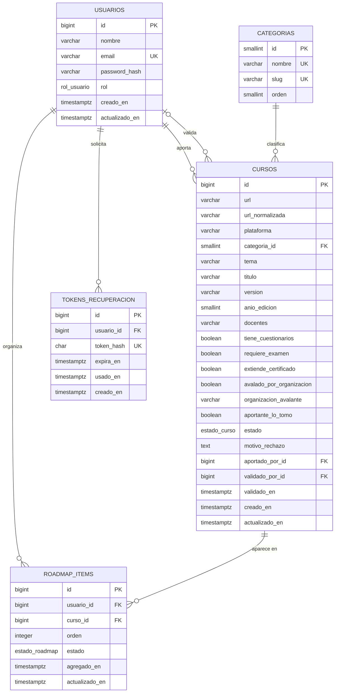
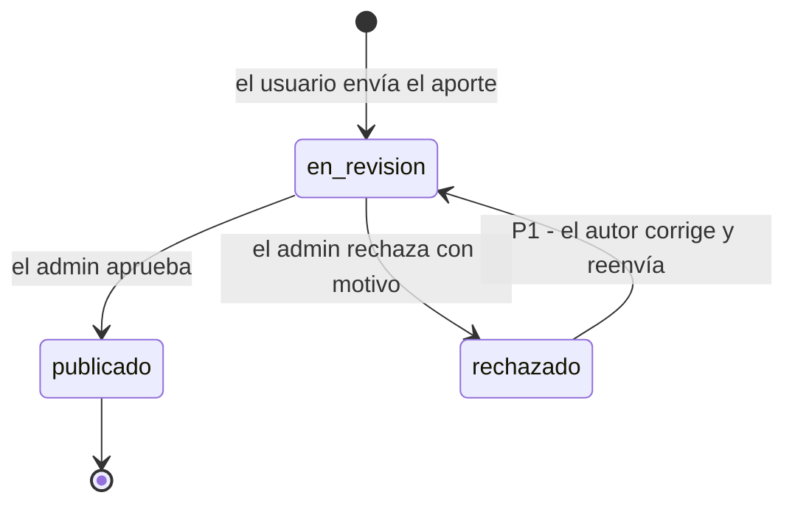

# BackendSchema — Esquema de base de datos y APIs — Senda

> **Qué es:** el contrato del backend de Senda: modelo de datos en PostgreSQL 18.6 y superficie de
> la API REST. Todo endpoint que usa una pantalla del [APPFlow](APPFlow.md) está acá, con sus
> respuestas y errores. Las decisiones de fondo (auth, paginación, errores) están en el [TRD](TRD.md).

## 1. Modelo de datos

### 1.1 Diagrama entidad-relación



**Tipos enumerados (PostgreSQL `CREATE TYPE … AS ENUM`):**

- `rol_usuario`: `usuario`, `admin`
- `estado_curso`: `en_revision`, `publicado`, `rechazado`
- `estado_roadmap`: `pendiente`, `en_curso`, `completado`

### 1.2 Tablas

Todas las claves primarias son `bigint GENERATED ALWAYS AS IDENTITY` (salvo `categorias`,
`smallint`). Los timestamps son `timestamptz` en UTC con `DEFAULT now()`; `actualizado_en` lo
actualiza la aplicación en cada `UPDATE`.

#### `usuarios`

| Columna | Tipo | Constraints | Notas |
|---------|------|-------------|-------|
| id | bigint identity | PK | |
| nombre | varchar(80) | NOT NULL, CHECK (char_length(nombre) BETWEEN 2 AND 80) | se muestra en el header |
| email | varchar(255) | NOT NULL, UNIQUE | se guarda en minúsculas y sin espacios (lo normaliza el service) |
| password_hash | varchar(60) | NOT NULL | hash bcrypt `$2b$12$…` (60 caracteres); nunca la contraseña en claro |
| rol | rol_usuario | NOT NULL, DEFAULT 'usuario' | el primer `admin` lo crea el seed |
| creado_en | timestamptz | NOT NULL, DEFAULT now() | |
| actualizado_en | timestamptz | NOT NULL, DEFAULT now() | |

**Índices:** `UNIQUE (email)` (búsqueda en login y registro).

#### `categorias`

| Columna | Tipo | Constraints | Notas |
|---------|------|-------------|-------|
| id | smallint identity | PK | |
| nombre | varchar(60) | NOT NULL, UNIQUE | lista cerrada, cargada por seed |
| slug | varchar(60) | NOT NULL, UNIQUE | para URLs legibles a futuro |
| orden | smallint | NOT NULL, DEFAULT 0 | orden de presentación en selects y chips |

**Seed (lista cerrada, 10 categorías):** Programación · Bases de datos · Desarrollo web ·
Ciencia de datos e IA · Redes e infraestructura · Ciberseguridad · Diseño UX/UI ·
Matemática y estadística · Idiomas · Gestión y negocios.

#### `cursos`

Un aporte **es** un curso en estado `en_revision`: una sola tabla con su ciclo de vida (§2).

| Columna | Tipo | Constraints | Notas |
|---------|------|-------------|-------|
| id | bigint identity | PK | |
| url | varchar(2048) | NOT NULL, CHECK (url ~ '^https?://') | enlace web activo, tal como lo cargó el aportante |
| url_normalizada | varchar(2048) | NOT NULL | esquema y host en minúsculas, sin `www.`, sin barra final, sin `#fragmento` ni parámetros `utm_*` (BR-005) |
| plataforma | varchar(100) | NOT NULL, CHECK (char_length BETWEEN 2 AND 100) | proveedor: Coursera, YouTube, edX… |
| categoria_id | smallint | NOT NULL, FK → categorias(id) | |
| tema | varchar(120) | NOT NULL, CHECK (char_length BETWEEN 2 AND 120) | |
| titulo | varchar(200) | NOT NULL, CHECK (char_length BETWEEN 3 AND 200) | |
| version | varchar(50) | NOT NULL, CHECK (char_length BETWEEN 1 AND 50) | texto libre: "v3", "2.ª edición", "2025" |
| anio_edicion | smallint | NOT NULL, CHECK (anio_edicion >= 1990) | el tope (año actual) lo valida el service (BR-009) |
| docentes | varchar(300) | NOT NULL, CHECK (char_length BETWEEN 2 AND 300) | docentes o disertantes separados por coma |
| tiene_cuestionarios | boolean | NOT NULL | |
| requiere_examen | boolean | NOT NULL | |
| extiende_certificado | boolean | NOT NULL | |
| avalado_por_organizacion | boolean | NOT NULL | |
| organizacion_avalante | varchar(150) | NULL, CHECK ((avalado_por_organizacion AND organizacion_avalante IS NOT NULL) OR (NOT avalado_por_organizacion AND organizacion_avalante IS NULL)) | BR-008 |
| aportante_lo_tomo | boolean | NOT NULL (sin DEFAULT) | declaración de toma (BR-002) |
| estado | estado_curso | NOT NULL, DEFAULT 'en_revision' | §2 |
| motivo_rechazo | text | NULL, CHECK ((estado = 'rechazado') = (motivo_rechazo IS NOT NULL)) | 10 a 500 caracteres (lo valida el service) |
| aportado_por_id | bigint | NOT NULL, FK → usuarios(id) ON DELETE RESTRICT | |
| validado_por_id | bigint | NULL, FK → usuarios(id) ON DELETE SET NULL | admin que decidió |
| validado_en | timestamptz | NULL | fecha de la decisión; ordena el catálogo |
| creado_en | timestamptz | NOT NULL, DEFAULT now() | fecha del aporte; ordena los pendientes |
| actualizado_en | timestamptz | NOT NULL, DEFAULT now() | |

**Índices:**

- `UNIQUE (url_normalizada) WHERE estado <> 'rechazado'` — índice único **parcial**: garantiza
  BR-005 y libera la URL si el aporte se rechaza (TRD TD-012).
- `(estado, validado_en DESC)` — listado del catálogo (`estado = 'publicado'` ordenado por fecha).
- `(estado, creado_en)` — pendientes de validación, del más antiguo al más nuevo.
- `(categoria_id)` — filtro por categoría.
- `(aportado_por_id, creado_en DESC)` — "Mis aportes".

#### `roadmap_items`

| Columna | Tipo | Constraints | Notas |
|---------|------|-------------|-------|
| id | bigint identity | PK | |
| usuario_id | bigint | NOT NULL, FK → usuarios(id) ON DELETE CASCADE | dueño del roadmap (BR-004) |
| curso_id | bigint | NOT NULL, FK → cursos(id) ON DELETE CASCADE | solo cursos `publicado` (lo valida el service, BR-006) |
| orden | integer | NOT NULL, CHECK (orden >= 1) | al agregar: `max(orden) + 1` del usuario (BR-007) |
| estado | estado_roadmap | NOT NULL, DEFAULT 'pendiente' | |
| agregado_en | timestamptz | NOT NULL, DEFAULT now() | |
| actualizado_en | timestamptz | NOT NULL, DEFAULT now() | |

**Índices:** `UNIQUE (usuario_id, curso_id)` (sin duplicados, BR-006) · `(usuario_id, orden)`
(listado ordenado y paginado).

#### `tokens_recuperacion`

| Columna | Tipo | Constraints | Notas |
|---------|------|-------------|-------|
| id | bigint identity | PK | |
| usuario_id | bigint | NOT NULL, FK → usuarios(id) ON DELETE CASCADE | |
| token_hash | char(64) | NOT NULL, UNIQUE | SHA-256 en hex del token; el token en claro solo viaja en el mail |
| expira_en | timestamptz | NOT NULL | `creado_en + 30 minutos` |
| usado_en | timestamptz | NULL | se completa al usarlo; un token usado no vuelve a servir |
| creado_en | timestamptz | NOT NULL, DEFAULT now() | |

**Índices:** `UNIQUE (token_hash)` · `(usuario_id)`. Al confirmar una contraseña nueva se marcan
como usados todos los tokens pendientes de ese usuario.

## 2. Estados del ciclo de vida del curso



| Estado | Quién lo ve | Qué puede pasar |
|--------|-------------|-----------------|
| `en_revision` | el autor (Mis aportes) y los admin (Validación) | el admin aprueba o rechaza |
| `publicado` | todos (catálogo público) | cualquier usuario lo agrega a su roadmap; no se edita ni se despublica en el MVP |
| `rechazado` | el autor (con el motivo) y los admin | P1: el autor lo corrige y reenvía (vuelve a `en_revision`, se limpia el motivo) |

Estados del ítem de roadmap: `pendiente` ⇄ `en_curso` ⇄ `completado`, en cualquier orden (el
usuario puede volver atrás).

## 3. API REST

**Convención general:**

- Prefijo `/api/v1`. JSON en request y response (UTF-8). Timestamps en ISO 8601 UTC.
- **Autenticación:** header `Authorization: Bearer <access_token>` (TRD TD-001). "Pública" = sin
  token; "sesión" = token válido; "admin" = token válido con `rol = admin`. Los endpoints públicos
  del catálogo aceptan el token de forma **opcional** para completar `en_mi_roadmap`.
- **Paginación (TD-002), en todos los listados:** `?page=1&page_size=12` (`page` ≥ 1; `page_size`
  de 1 a 100, default 12). Una página fuera de rango devuelve `200` con `items: []`.

  ```json
  { "items": [], "total": 47, "page": 4, "page_size": 12, "pages": 4 }
  ```

- **Errores (TD-008):** `{ "error": { "code": "...", "message": "...", "details": ... } }`.

  | Código HTTP | `code` | Cuándo |
  |-------------|--------|--------|
  | 400 | `TOKEN_INVALIDO` | token de recuperación inexistente, vencido o usado |
  | 401 | `NO_AUTENTICADO` | falta el token, es inválido o venció |
  | 401 | `CREDENCIALES_INVALIDAS` | email o contraseña incorrectos en login |
  | 403 | `PROHIBIDO` | rol insuficiente o recurso de otro usuario |
  | 404 | `NO_ENCONTRADO` | recurso inexistente o no visible para quien pregunta |
  | 409 | `EMAIL_REGISTRADO` · `CURSO_DUPLICADO` · `YA_EN_ROADMAP` · `YA_VALIDADO` · `APORTE_NO_EDITABLE` | conflictos de reglas de negocio |
  | 422 | `VALIDACION` | datos inválidos; `details` = `[{ "campo", "mensaje" }]` |
  | 405 | `METODO_NO_PERMITIDO` | el método HTTP no existe para esa ruta |
  | 429 | `DEMASIADOS_INTENTOS` | rate limit; header `Retry-After` en segundos |
  | 503 | `BD_NO_DISPONIBLE` | la base de datos no responde (§3.6) |
  | 500 | `ERROR_INTERNO` | error no previsto (se loggea) |

**Objetos reutilizados en las respuestas:**

```jsonc
// CursoResumen (cards y listados)
{
  "id": 12,
  "titulo": "Introducción a SQL",
  "plataforma": "Coursera",
  "categoria": { "id": 2, "nombre": "Bases de datos" },
  "anio_edicion": 2025,
  "docentes": "Ana Pérez, Juan Gómez",
  "tiene_cuestionarios": true,
  "requiere_examen": false,
  "extiende_certificado": true,
  "avalado_por_organizacion": true,
  "en_mi_roadmap": false
}

// CursoDetalle = CursoResumen + estos campos
{
  "url": "https://www.coursera.org/learn/intro-sql",
  "tema": "Consultas SELECT, JOIN y agregaciones",
  "version": "2.ª edición",
  "organizacion_avalante": "Universidad de Michigan",
  "aportante_lo_tomo": true,
  "aportado_por": { "id": 5, "nombre": "Martín" },
  "validado_en": "2026-10-22T14:03:00Z"
}

// Aporte = CursoDetalle (sin en_mi_roadmap) + estos campos
{
  "estado": "rechazado",
  "motivo_rechazo": "El curso es pago: requiere suscripción mensual.",
  "creado_en": "2026-10-21T18:40:00Z"
}
```

`en_mi_roadmap` es `null` cuando la request no trae token.

### 3.1 Autenticación (`identidad`)

| Método | Path | Auth | Request | Respuestas |
|--------|------|------|---------|------------|
| POST | `/api/v1/auth/registro` | pública | `{ "nombre": "Lucía", "email": "lucia@mail.com", "password": "clave1234" }` | `201` `{ "id", "nombre", "email", "rol" }` · `409 EMAIL_REGISTRADO` · `422` |
| POST | `/api/v1/auth/login` | pública · **rate limit 5/min por IP** | `{ "email": "...", "password": "..." }` | `200` `{ "access_token": "eyJ…", "token_type": "bearer", "expira_en": 3600, "usuario": { "id", "nombre", "email", "rol" } }` · `401 CREDENCIALES_INVALIDAS` · `422` · `429` |
| GET | `/api/v1/auth/me` | sesión | — | `200` `{ "id", "nombre", "email", "rol" }` · `401` |
| POST | `/api/v1/auth/recuperacion` | pública · **rate limit 3/15 min por IP** | `{ "email": "..." }` | `202` `{ "mensaje": "Si el email está registrado, te enviamos un enlace." }` (siempre igual) · `422` · `429` |
| POST | `/api/v1/auth/recuperacion/confirmar` | pública | `{ "token": "…", "password": "nuevaClave99" }` | `204` · `400 TOKEN_INVALIDO` · `422` |

- **Contraseña:** 8 a 64 caracteres, al menos una letra y un número, ≤ 72 bytes (límite bcrypt).
- **Logout:** no hay endpoint; el cliente descarta el token (TRD TD-001).
- **JWT:** HS256, claims `sub` (id de usuario), `rol`, `iat`, `exp` (60 min).

### 3.2 Catálogo: cursos y categorías

| Método | Path | Auth | Query / Request | Respuestas |
|--------|------|------|-----------------|------------|
| GET | `/api/v1/categorias` | pública | `page`, `page_size` (el front pide `page_size=100`) | `200` paginado de `{ "id", "nombre", "slug" }` ordenado por `orden` |
| GET | `/api/v1/cursos` | pública (token opcional) | `page`, `page_size`, `categoria_id` (int), `q` (2 a 100 caracteres: busca en título, tema, plataforma y docentes, sin distinguir mayúsculas) | `200` paginado de `CursoResumen`, solo `publicado`, ordenado por `validado_en DESC` · `422` (`categoria_id` inexistente, `q` fuera de rango) |
| GET | `/api/v1/cursos/{id}` | pública (token opcional) | — | `200` `CursoDetalle` · `404` si no existe o no está `publicado` |

> **Estado en v0.1.0:** `GET /api/v1/cursos` ya responde con este contrato (paginación,
> `categoria_id` y `q` incluidos) usando cursos de ejemplo en memoria. En M2 (tareas 2.1 a 2.4)
> pasa a leer de PostgreSQL sin cambiar la respuesta. `GET /cursos/{id}` y `GET /categorias`
> llegan en M2.

Ejemplo `GET /api/v1/cursos?page=1&page_size=2&categoria_id=2` → `200`:

```json
{
  "items": [
    { "id": 12, "titulo": "Introducción a SQL", "plataforma": "Coursera",
      "categoria": { "id": 2, "nombre": "Bases de datos" }, "anio_edicion": 2025,
      "docentes": "Ana Pérez, Juan Gómez", "tiene_cuestionarios": true,
      "requiere_examen": false, "extiende_certificado": true,
      "avalado_por_organizacion": true, "en_mi_roadmap": null }
  ],
  "total": 7,
  "page": 1,
  "page_size": 2,
  "pages": 4
}
```

### 3.3 Aportes

| Método | Path | Auth | Request / Query | Respuestas |
|--------|------|------|-----------------|------------|
| POST | `/api/v1/aportes` | sesión | `{ "url", "plataforma", "categoria_id", "tema", "titulo", "version", "anio_edicion", "docentes", "tiene_cuestionarios", "requiere_examen", "extiende_certificado", "avalado_por_organizacion", "organizacion_avalante", "aportante_lo_tomo" }` | `201` `Aporte` con `estado: "en_revision"` · `409 CURSO_DUPLICADO` · `422` |
| GET | `/api/v1/aportes/mios` | sesión | `page`, `page_size`, `estado` (opcional) | `200` paginado de `Aporte` del usuario, por `creado_en DESC` |
| GET | `/api/v1/aportes/{id}` | sesión (autor o admin) | — | `200` `Aporte` · `403` (no es el autor ni admin) · `404` |
| PUT | `/api/v1/aportes/{id}` | sesión (autor) — **P1** | mismo cuerpo que el POST | `200` `Aporte` con `estado: "en_revision"` y `motivo_rechazo: null` · `403` · `404` · `409 APORTE_NO_EDITABLE` (no está `rechazado`) · `409 CURSO_DUPLICADO` · `422` |

Validaciones del cuerpo: `url` http/https de hasta 2048 caracteres · `categoria_id` existente ·
`anio_edicion` entre 1990 y el año actual · `organizacion_avalante` obligatoria si
`avalado_por_organizacion` es `true` (se ignora si es `false`) · `aportante_lo_tomo` obligatorio
(no tiene default) · longitudes de §1.2.

### 3.4 Validación (solo admin)

| Método | Path | Auth | Request / Query | Respuestas |
|--------|------|------|-----------------|------------|
| GET | `/api/v1/validacion/pendientes` | admin | `page`, `page_size` | `200` paginado de `Aporte` en `en_revision`, por `creado_en ASC` · `401` · `403` |
| POST | `/api/v1/validacion/{id}/decision` | admin | `{ "aprobado": true }` o `{ "aprobado": false, "motivo": "texto de 10 a 500 caracteres" }` | `200` `Aporte` actualizado (`publicado` o `rechazado`, con `validado_en`) · `403` · `404` · `409 YA_VALIDADO` · `422` (falta el motivo al rechazar) |

### 3.5 Roadmap del usuario

| Método | Path | Auth | Request / Query | Respuestas |
|--------|------|------|-----------------|------------|
| GET | `/api/v1/roadmap` | sesión | `page`, `page_size`, `estado` (opcional) | `200` paginado de `{ "id", "orden", "estado", "agregado_en", "curso": CursoResumen }` por `orden ASC`, más `"resumen": { "total", "completados" }` |
| POST | `/api/v1/roadmap/items` | sesión | `{ "curso_id": 12 }` | `201` ítem creado (al final, `pendiente`) · `404` (curso inexistente o no `publicado`) · `409 YA_EN_ROADMAP` · `422` |
| PATCH | `/api/v1/roadmap/items/{id}` | sesión (dueño) | `{ "estado": "en_curso" }` · P1: `{ "orden": 2 }` (intercambia con el ítem que ocupa esa posición) | `200` ítem actualizado · `404` (inexistente o de otro usuario) · `422` |
| DELETE | `/api/v1/roadmap/items/{id}` | sesión (dueño) | — | `204` · `404` |

Los ítems de otro usuario responden `404` (no `403`) para no revelar que existen.

### 3.6 Salud

| Método | Path | Auth | Respuestas |
|--------|------|------|------------|
| GET | `/health` | pública | `200` `{ "status": "ok" }` — la API está viva; fuera del prefijo `/api/v1` y sin tocar la base |
| GET | `/api/v1/health` | pública | `200` `{ "status": "ok", "db": "ok" }` · `503 BD_NO_DISPONIBLE` si la base no responde |

`GET /health` es el chequeo que pide la consigna de la clase del 27/10
(`curl http://localhost:8000/health` → `{"status":"ok"}`).

### 3.7 Trazabilidad pantalla → endpoint

| Pantalla ([APPFlow](APPFlow.md)) | Endpoints |
|----------------------------------|-----------|
| Shell (al iniciar) | `GET /auth/me` |
| Home | `GET /cursos`, `GET /categorias` |
| Catálogo | `GET /cursos`, `GET /categorias` |
| Detalle de curso | `GET /cursos/{id}`, `POST /roadmap/items` |
| Registro | `POST /auth/registro` |
| Login | `POST /auth/login` |
| Recuperar contraseña | `POST /auth/recuperacion` |
| Nueva contraseña | `POST /auth/recuperacion/confirmar` |
| Aportar curso | `GET /categorias`, `POST /aportes` |
| Mis aportes | `GET /aportes/mios` |
| Detalle de mi aporte | `GET /aportes/{id}` |
| Editar aporte (P1) | `GET /aportes/{id}`, `GET /categorias`, `PUT /aportes/{id}` |
| Mi roadmap | `GET /roadmap`, `PATCH /roadmap/items/{id}`, `DELETE /roadmap/items/{id}`, `POST /roadmap/items` (deshacer) |
| Validación — pendientes | `GET /validacion/pendientes` |
| Revisión de aporte | `GET /aportes/{id}`, `POST /validacion/{id}/decision` |

## 4. Decisiones del esquema

| Decisión | Alternativas | Por qué |
|----------|--------------|---------|
| Aporte y curso en **una sola tabla** `cursos` con `estado` | tabla `aportes` separada que "copia" a `cursos` al aprobar | un curso es un aporte que llegó a `publicado`: una sola fila evita copiar datos y desincronizarlos; el estado ya distingue catálogo de revisión |
| Categorías como **tabla con FK** | `ENUM` de PostgreSQL / texto libre | la lista cerrada se carga por seed y se ordena; agregar una categoría no requiere migrar un tipo |
| Estados como **ENUM** de PostgreSQL | tabla de estados / `varchar` con `CHECK` | los estados son fijos y los valida la base; son parte del ciclo de vida y cambian solo con migración |
| Flags de cuestionarios, examen, certificado y aval como **booleanos `NOT NULL`** | JSONB de "características" | se filtran y validan por columna; `NOT NULL` obliga a responder cada pregunta de la SPEC |
| Duplicados por **índice único parcial** sobre `url_normalizada` | `UNIQUE (url)` simple / sin control | evita el mismo curso con variantes de URL y permite volver a aportar una URL rechazada (BR-005) |
| Docentes como **texto** (hasta 300 caracteres) | entidad `docentes` N:M | el MVP solo los muestra; una entidad sumaría tablas y un ABM sin una historia que lo pida |
| Roadmap como **tabla intermedia** con `orden` y `estado` | array de ids en `usuarios` / JSONB | integridad referencial, `UNIQUE (usuario_id, curso_id)` y paginación por SQL (TRD TD-004) |
| Token de recuperación **hasheado** (SHA-256) | guardar el token en claro / JWT de reset | una filtración de la base no permite resetear contraseñas; un uso y vencimiento se controlan con columnas |
| `bigint identity` como PK | `uuid` / `serial` | `identity` es el estándar SQL que recomienda PostgreSQL sobre `serial`; ids secuenciales alcanzan porque todo acceso a recursos privados se controla por dueño |

---

**Referencias:**
- Mermaid — Entity Relationship Diagrams: https://mermaid.js.org/syntax/entityRelationshipDiagram.html
- PostgreSQL — The Conceptual Model (tablas, constraints, índices): https://www.postgresql.org/docs/current/datamodel.html
