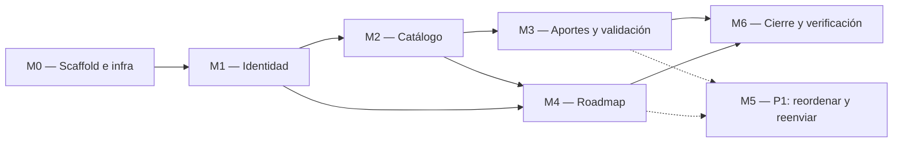

# Implementation Plan — Senda

> **Qué es:** el orden de construcción de Senda para la Instancia B: módulos, dependencias,
> tareas con su definición de hecho verificable, estimaciones y la rama de cada tarea según el
> flujo de Git del [TRD §4.1](TRD.md#41-flujo-de-git--github-flow-adaptado).
> Se ejecuta **solo después del correo APROBADO con el T1**.

## 1. MVP — qué es P0

> Criterio de MVP: en una máquina limpia, `git clone` + seguir el README + `docker compose up`,
> y recorrer de punta a punta estas historias del [PRD](PRD.md#4-user-stories) desde la UI,
> sin errores en la consola del navegador:

- **US-001:** ver el catálogo paginado, filtrar por categoría y buscar por texto.
- **US-002:** ver el detalle completo de un curso publicado.
- **US-003:** registrarse.
- **US-004:** iniciar y cerrar sesión, con rate limiting en el login.
- **US-005:** recuperar la contraseña (pedido → mail en Mailpit → nueva contraseña).
- **US-006:** aportar un curso con todos los datos y la declaración de toma.
- **US-007:** ver mis aportes con su estado y el motivo de rechazo.
- **US-008:** como admin, aprobar o rechazar aportes pendientes.
- **US-009:** agregar un curso publicado a mi roadmap.
- **US-010:** gestionar mi roadmap (ver paginado, cambiar estado, quitar).

**Fuera del MVP (P1, módulo M5):** US-011 reordenar el roadmap · US-012 corregir y reenviar un aporte rechazado.

**Pregunta de cierre del lunes 26/10 a las 22:00:** ¿en una máquina limpia, con `docker compose up`,
funcionan US-001 a US-010 desde la UI? Sí / No.

## 2. Módulos y dependencias

- **M1 antes que todo lo demás:** aportar, validar y el roadmap necesitan sesión y roles.
- **M2 antes que M3 y M4:** la tabla `cursos` y las categorías nacen en M2; M3 escribe en ella y
  M4 la referencia.
- **M3 y M4 son independientes entre sí:** se pueden hacer en cualquier orden.
- **M5 (P1) es opcional:** solo si M6 está cerrado y sobra tiempo.

## 3. Detalle por módulo

### M0 — Scaffold e infraestructura

| # | Tarea | Hecho cuando… | Estimación |
|---|-------|----------------|------------|
| 0.1 | Estructura de carpetas del TRD §3.2 (dominios en back y front) | `find backend/app frontend/src -type d` muestra `identidad`, `catalogo`, `aportes`, `validacion`, `roadmap` en ambos lados | 30 min |
| 0.2 | `docker-compose.yml` con `postgres:18.6` (volumen en `/var/lib/postgresql`, healthcheck `pg_isready`) y `mailpit` | `docker compose up -d postgres mailpit` → `docker compose ps` muestra postgres `healthy`; `http://localhost:8025` abre la bandeja; tras `down` y `up` los datos persisten | 45 min |
| 0.3 | Backend FastAPI 0.158.2 con uv: `pyproject.toml`, `Dockerfile`, `config.py`, `compartido/` (db, errores, paginación) y `GET /api/v1/health` | `curl -s localhost:8000/api/v1/health` → `200 {"status":"ok","db":"ok"}`; un endpoint inexistente responde con el envelope de error | 1 h 30 min |
| 0.4 | Alembic configurado; el contenedor corre `alembic upgrade head` y el seed al iniciar | `docker compose exec backend uv run alembic current` muestra la última revisión | 45 min |
| 0.5 | Frontend Vite 8 + React 19 + React Router 7: `tokens.css`, `base.css`, `Layout`, `Header`, menú sándwich accesible, página 404, proxy `/api` | a 360 px se ve la hamburguesa; el drawer abre, atrapa el foco y cierra con `Esc`, link y scrim; a ≥ 840 px la navegación está en el header; `/no-existe` muestra la 404; `grep -rn "@media" frontend/src` solo muestra `min-width` | 2 h 30 min |
| 0.6 | Compose completo: `frontend` + `backend` + `postgres` + `mailpit` con defaults de desarrollo | desde cero, `docker compose up` levanta los 4 servicios; `localhost:5173` muestra el shell y `localhost:5173/api/v1/health` responde vía proxy | 30 min |

### M1 — Identidad (registro, login, rate limit, recuperación)

| # | Tarea | Hecho cuando… | Estimación |
|---|-------|----------------|------------|
| 1.1 | Modelo `usuarios` + enum `rol_usuario` + migración | `\d usuarios` en psql muestra columnas, `UNIQUE (email)` y el enum | 30 min |
| 1.2 | `POST /auth/registro` con bcrypt costo 12 y política de contraseña | curl válido → `201`; mismo email → `409 EMAIL_REGISTRADO`; contraseña sin número → `422`; `SELECT password_hash` empieza con `$2b$12$` | 1 h |
| 1.3 | `POST /auth/login` (JWT HS256, 60 min), `GET /auth/me`, dependencias `get_usuario_actual` y `require_admin` | login válido → `200` con `access_token`; `/auth/me` con token → `200`, sin token → `401`; credenciales malas → `401 CREDENCIALES_INVALIDAS` | 1 h 15 min |
| 1.4 | Rate limit con slowapi en login (5/min por IP) | 6 logins fallidos seguidos → el sexto responde `429 DEMASIADOS_INTENTOS` con header `Retry-After` | 45 min |
| 1.5 | Recuperación: tabla `tokens_recuperacion` + `POST /auth/recuperacion` (202, 3/15 min, mail SMTP) + `POST /auth/recuperacion/confirmar` | pedir con un email registrado → el mail aparece en `localhost:8025` con el enlace; con ese token se cambia la contraseña (`204`) y el login funciona con la nueva; reusar el token → `400 TOKEN_INVALIDO`; email inexistente → igual `202` | 2 h |
| 1.6 | Seed idempotente: admin (variables `ADMIN_*`) y usuarios demo | dos `docker compose up` seguidos no duplican usuarios; login como admin devuelve `rol: "admin"` | 30 min |
| 1.7 | Front: `SessionContext`, cliente API con token, `RequiereSesion`, `RequiereAdmin`, manejo global de `401` | sin sesión, `/roadmap` lleva a `/login?next=/roadmap`; un token vencido o borrado en la base muestra "Tu sesión expiró" y lleva a login | 1 h 15 min |
| 1.8 | Pantallas Registro y Login (incluye estado `429` con cuenta regresiva) y "Salir" | [Flujo 4](APPFlow.md#flujo-4--registro-login-y-rate-limiting) completo desde la UI | 1 h 30 min |
| 1.9 | Pantallas Recuperar contraseña y Nueva contraseña | [Flujo 5](APPFlow.md#flujo-5--recuperar-la-contraseña) completo desde la UI, incluido el enlace vencido o usado | 1 h 15 min |

### M2 — Catálogo comunitario

| # | Tarea | Hecho cuando… | Estimación |
|---|-------|----------------|------------|
| 2.1 | Modelos `categorias` y `cursos` + enum `estado_curso` + índices (incluido el único parcial) + migración; seed de las 10 categorías | `\d cursos` muestra los `CHECK` y los 5 índices de BackendSchema §1.2; `SELECT count(*) FROM categorias` → 10 | 1 h 15 min |
| 2.2 | `GET /categorias` paginado | `curl "localhost:8000/api/v1/categorias?page_size=100"` → 10 ítems, `total: 10`, ordenados por `orden` | 20 min |
| 2.3 | Seed de cursos demo: 30 `publicado` en ≥ 6 categorías, 3 `en_revision` y 1 `rechazado` | `GET /cursos?page_size=12` → `total: 30`, `pages: 3`; los 3 pendientes no aparecen | 45 min |
| 2.4 | `GET /cursos` paginado con `categoria_id`, `q` y token opcional (`en_mi_roadmap` en `null` hasta M4) | `?page=3` → 6 ítems; `?q=sql` filtra sin distinguir mayúsculas; `?q=a` → `422`; nunca devuelve cursos `en_revision` ni `rechazado` | 1 h 30 min |
| 2.5 | `GET /cursos/{id}` | un publicado → `200 CursoDetalle`; uno `en_revision` → `404` | 20 min |
| 2.6 | Pantalla Catálogo con Card de curso, chips, filtros, Paginador, Skeleton y Empty state (+ hook `usePaginatedQuery`) | criterios de aceptación de US-001 cumplidos a 360 px y a 1280 px; la URL refleja `page`, `categoria` y `q` | 2 h 30 min |
| 2.7 | Pantalla Detalle de curso (ficha completa, "Ir al curso", 404) | criterios de US-002 cumplidos; "Ir al curso" abre pestaña nueva | 1 h 15 min |
| 2.8 | Pantalla Home (buscador, chips de categorías, últimos 6 cursos) | buscar "sql" lleva a `/catalogo?q=sql`; un chip lleva a `/catalogo?categoria=<id>` | 45 min |

### M3 — Aportes y ciclo de validación

| # | Tarea | Hecho cuando… | Estimación |
|---|-------|----------------|------------|
| 3.1 | `POST /aportes`: normalización de URL, duplicados, reglas de aval y año | válido → `201` con `en_revision`; la misma URL con `?utm_source=x` o barra final → `409 CURSO_DUPLICADO`; aval "sí" sin organización → `422`; sin `aportante_lo_tomo` → `422` | 1 h 30 min |
| 3.2 | `GET /aportes/mios` (paginado, filtro por estado) y `GET /aportes/{id}` (autor o admin) | con dos usuarios: cada uno ve solo los suyos; el aporte de otro → `403`; el admin ve cualquiera | 45 min |
| 3.3 | Pantalla Aportar (3 fieldsets, radio sin preselección, checkboxes, organización condicional, errores por campo) | [Flujo 1](APPFlow.md#flujo-1--aportar-un-curso-al-catálogo) completo desde la UI, incluidas las ramas de `422` y `409` | 2 h 30 min |
| 3.4 | Pantallas Mis aportes (cards / tabla, filtro por estado) y Detalle de mi aporte (motivo de rechazo) | criterios de US-007 cumplidos con los aportes del seed | 1 h 30 min |
| 3.5 | `GET /validacion/pendientes` y `POST /validacion/{id}/decision` | usuario común → `403`; aprobar → `publicado` y aparece en `GET /cursos`; rechazar sin motivo → `422`; decidir dos veces → `409 YA_VALIDADO` | 1 h 15 min |
| 3.6 | Pantallas Validación (pendientes) y Revisión (aprobar, diálogo de rechazo con motivo) | [Flujo 3](APPFlow.md#flujo-3--validación-de-un-aporte) completo desde la UI; un usuario común que entra a `/validacion` es redirigido con aviso | 2 h |

### M4 — Roadmap personal

| # | Tarea | Hecho cuando… | Estimación |
|---|-------|----------------|------------|
| 4.1 | Modelo `roadmap_items` + enum `estado_roadmap` + migración | `\d roadmap_items` muestra `UNIQUE (usuario_id, curso_id)` | 30 min |
| 4.2 | `GET /roadmap` (paginado, filtro, resumen), `POST /roadmap/items`, `PATCH` (estado), `DELETE`; `en_mi_roadmap` en el catálogo | agregar dos veces → `409 YA_EN_ROADMAP`; curso no publicado → `404`; ítem de otro usuario → `404`; `GET /cursos` con token marca `en_mi_roadmap: true` | 1 h 30 min |
| 4.3 | Botón "Agregar a mi roadmap" en Detalle y estado "En tu roadmap" en cards | [Flujo 2](APPFlow.md#flujo-2--descubrir-un-curso-y-agregarlo-a-mi-roadmap) pasos 4 y 5 desde la UI, incluido el desvío por login | 45 min |
| 4.4 | Pantalla Mi roadmap (select de estado, quitar con confirmación y "Deshacer", filtro, empty state) | criterios de US-010 cumplidos; el estado persiste al recargar | 2 h |

### M5 — P1 (solo si M6 está cerrado)

| # | Tarea | Hecho cuando… | Estimación |
|---|-------|----------------|------------|
| 5.1 | Reordenar el roadmap: `PATCH` con `orden` + botones subir/bajar | criterios de US-011 | 1 h 30 min |
| 5.2 | Corregir y reenviar un aporte rechazado: `PUT /aportes/{id}` + pantalla `/mis-aportes/:id/editar` | criterios de US-012 | 2 h |

### M6 — Cierre y verificación de la Instancia B

| # | Tarea | Hecho cuando… | Estimación |
|---|-------|----------------|------------|
| 6.1 | README de ejecución: requisitos, comandos exactos, URLs, usuarios demo y guía de prueba por historia | otra persona levanta el proyecto y prueba US-001 a US-010 solo con el README | 45 min |
| 6.2 | Verificación en máquina limpia y actualización de §4 | `git clone` en una carpeta nueva + `docker compose down -v` + `docker compose up` → US-001 a US-010 OK; §4 con todas las tareas P0 en `[x]` y su rama | 1 h 15 min |

**Estimación total P0 (M0–M4 + M6): ≈ 41 h.** Es mucho para un fin de semana: por eso el orden
deja un producto navegable al terminar M2 y el seed evita cargar datos a mano para probar.

## 4. Ejecución (Instancia B)

> **Regla:** 1 tarea (o lote coherente) = 1 rama con el nombre de esta tabla + commits
> convencionales + merge `--no-ff` a `main` ([TRD §4.1](TRD.md#41-flujo-de-git--github-flow-adaptado)).
> Esta tabla se actualiza al cerrar cada tarea con `[x]` y el SHA del merge.

| # | Tarea | Módulo | Estado | Rama / Commit |
|---|-------|--------|--------|---------------|
| 0.1 | Estructura de carpetas | M0 | [ ] | `chore/m0-estructura` |
| 0.2 | Compose: postgres + mailpit | M0 | [ ] | `docker/m0-compose-postgres-mailpit` |
| 0.3 | Backend base + health | M0 | [ ] | `feat/m0-backend-base` |
| 0.4 | Alembic | M0 | [ ] | `feat/m0-alembic` |
| 0.5 | Frontend shell + menú sándwich | M0 | [ ] | `feat/m0-frontend-shell` |
| 0.6 | Compose completo | M0 | [ ] | `docker/m0-compose-completo` |
| 1.1 | Modelo usuarios | M1 | [ ] | `feat/m1-modelo-usuarios` |
| 1.2 | Registro | M1 | [ ] | `feat/m1-registro` |
| 1.3 | Login JWT + me | M1 | [ ] | `feat/m1-login-jwt` |
| 1.4 | Rate limit login | M1 | [ ] | `feat/m1-login-rate-limit` |
| 1.5 | Recuperación de contraseña (API) | M1 | [ ] | `feat/m1-recuperacion` |
| 1.6 | Seed de usuarios | M1 | [ ] | `feat/m1-seed-usuarios` |
| 1.7 | Sesión en el front | M1 | [ ] | `feat/m1-sesion-front` |
| 1.8 | Pantallas registro y login | M1 | [ ] | `feat/m1-pantallas-login-registro` |
| 1.9 | Pantallas de recuperación | M1 | [ ] | `feat/m1-pantallas-recuperacion` |
| 2.1 | Modelos categorías y cursos | M2 | [ ] | `feat/m2-modelo-cursos` |
| 2.2 | API categorías | M2 | [ ] | `feat/m2-categorias-api` |
| 2.3 | Seed de cursos | M2 | [ ] | `feat/m2-seed-cursos` |
| 2.4 | API listado de cursos | M2 | [ ] | `feat/m2-cursos-listado-api` |
| 2.5 | API detalle de curso | M2 | [ ] | `feat/m2-curso-detalle-api` |
| 2.6 | Pantalla catálogo | M2 | [ ] | `feat/m2-pantalla-catalogo` |
| 2.7 | Pantalla detalle | M2 | [ ] | `feat/m2-pantalla-detalle` |
| 2.8 | Pantalla home | M2 | [ ] | `feat/m2-pantalla-home` |
| 3.1 | API alta de aportes | M3 | [ ] | `feat/m3-aportes-alta-api` |
| 3.2 | API mis aportes | M3 | [ ] | `feat/m3-mis-aportes-api` |
| 3.3 | Pantalla aportar | M3 | [ ] | `feat/m3-pantalla-aportar` |
| 3.4 | Pantallas mis aportes | M3 | [ ] | `feat/m3-pantallas-mis-aportes` |
| 3.5 | API validación | M3 | [ ] | `feat/m3-validacion-api` |
| 3.6 | Pantallas validación | M3 | [ ] | `feat/m3-pantallas-validacion` |
| 4.1 | Modelo roadmap | M4 | [ ] | `feat/m4-modelo-roadmap` |
| 4.2 | API roadmap | M4 | [ ] | `feat/m4-roadmap-api` |
| 4.3 | Agregar desde el detalle | M4 | [ ] | `feat/m4-agregar-desde-detalle` |
| 4.4 | Pantalla roadmap | M4 | [ ] | `feat/m4-pantalla-roadmap` |
| 6.1 | README de ejecución | M6 | [ ] | `docs/m6-readme-ejecucion` |
| 6.2 | Verificación en máquina limpia | M6 | [ ] | `docs/m6-cierre-plan` |
| 5.1 | Reordenar roadmap (P1) | M5 | [ ] | `feat/m5-reordenar-roadmap` |
| 5.2 | Reenviar aporte rechazado (P1) | M5 | [ ] | `feat/m5-reenviar-aporte` |

## 5. Estrategia de testing

> Se **planifica** acá y se **implementa** en la clase del 27/10.

- **Unit tests (services, pytest, patrón AAA, sin BD ni HTTP):**
  - `normalizar_url`: esquema y host en minúsculas, `www.`, barra final, `#fragmento`, `utm_*`.
  - reglas del aporte: aval con y sin organización, año fuera de rango, declaración ausente.
  - transiciones de validación: solo desde `en_revision`; rechazo sin motivo; doble decisión.
  - reglas del roadmap: duplicado, curso no publicado, `orden` siguiente, cambio de estado.
  - política de contraseña (letras, números, 72 bytes) y token de recuperación (vencido, usado).
- **Integration tests (routers + repositories, `TestClient` de FastAPI):** contra una base
  `senda_test` en el PostgreSQL del compose (no SQLite: los ENUM y el índice único parcial son
  propios de PostgreSQL), con transacción revertida por test. Casos: paginación (`total`, `pages`,
  página fuera de rango), permisos `401`/`403`/`404`, `409` de duplicados, rate limit `429`.
- **Frontend (Vitest + Testing Library):** `usePaginatedQuery` (loading, éxito, error, cambio de
  página), cliente API (un `401` limpia la sesión), Paginador (rango visible, `aria-current`),
  validadores del formulario de aporte.
- **Objetivo de cobertura:** ≥ 80 % de líneas en `app/*/service.py`
  (`pytest --cov=app --cov-report=term-missing`) y ≥ 70 % en `src/compartido/hooks`.

## 6. Riesgos del plan

| Riesgo | Impacto | Mitigación |
|--------|---------|------------|
| ≈ 41 h de P0 en un fin de semana | alto | empezar apenas llega el T1; orden por dependencias que deja un MVP navegable al cerrar M2; revisar estimaciones al cerrar cada módulo; M5 queda fuera del MVP |
| El formulario de aporte tiene 14 campos con reglas cruzadas | medio | las reglas se escriben una vez en el schema Pydantic y se reflejan en validadores puros del front, ambos tomados de BackendSchema §3.3 |
| Detrás del proxy de Vite todas las requests llegan con la IP del contenedor `frontend`, y el rate limit se vuelve global | medio | proxy con `xfwd: true` y `key_func` de slowapi que use `X-Forwarded-For` solo en desarrollo; probado en la tarea 1.4 |
| El mail de recuperación no sale desde el contenedor | medio | Mailpit levantado y verificado en 0.2; la tarea 1.5 prueba el envío real antes de hacer las pantallas |
| Volumen de PostgreSQL 18 montado en la ruta vieja | alto | volumen en `/var/lib/postgresql` (TRD §3.3) y prueba de persistencia en 0.2 |
| Diferencias entre la máquina propia y una limpia (puertos ocupados, `.env` olvidado) | alto | defaults de desarrollo en el compose (no hace falta `.env`) y verificación con clon nuevo en 6.2 |

---

**Referencias:**
- Atlassian — Plantilla de plan de proyecto: https://www.atlassian.com/software/confluence/templates/project-plan
- Shape Up — cómo partir trabajo real en scopes cerrables: https://basecamp.com/shapeup/
